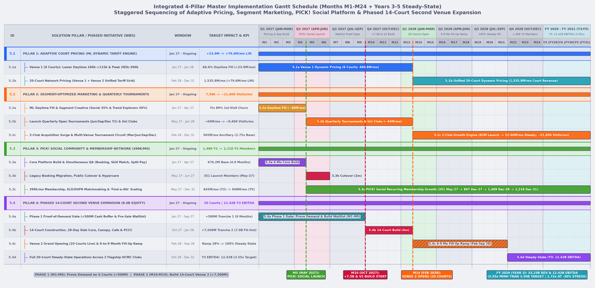
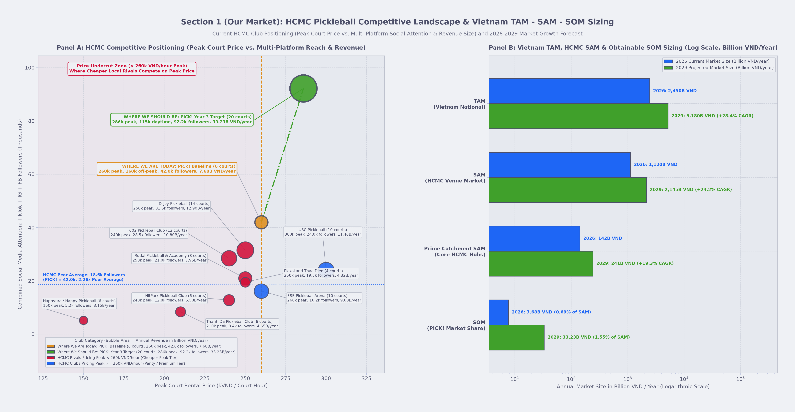
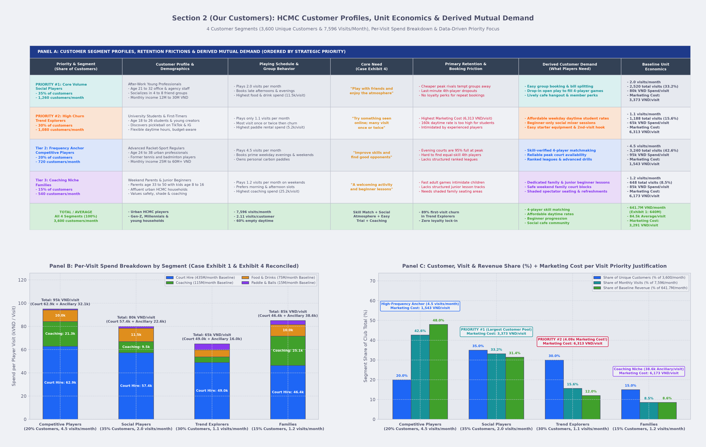

# Vietnam Commerce Case Competition - PICK! Strategic & Financial Plan

> **AI Usage Acknowledgement**  
> - **Human Problem Framing, Architecture & Analytical Direction**: Our team performed the core strategic diagnosis, evaluated the case's strategic options, and architected the modular solution (`MarketResearch`, `AdaptivePricing`, `PickSocialProjectTimeline`, `VenueScalingTimeline`, `Marketing`, and `FinancialModel`) - including the decisions to use ML for dynamic court pricing and segment marketing budget allocation, sequence the platform launch before the second venue expansion, and model all assumptions as bounded probability distributions. Throughout development, we analyzed intermediate outputs, directed how data was decomposed, split (`Train`/`Test` without look-ahead), and constrained to case exhibits, and calibrated every financial and operational assumption.  
> - **AI-Accelerated Implementation & Prototyping**: We used **OpenAI Codex** and **Google Antigravity** to accelerate code implementation, rapidly prototype and stress-test alternative strategic paths, execute the data-driven simulation and machine learning pipelines, and iterate on adjustments and visualizations under our review.

---

## 0. Executive Summary

PICK! has already won the attention game (`42,000` TikTok and Instagram followers and `90%-95%` peak court occupancy), but **attention is not loyalty**: `60%` of weekday daytime courts sit empty, `30%` of customers are one-off *Trend Explorers*, and `100%` of revenue is transactional. Within Investor Minh Tran's **`8,000M VND` investment ceiling** (`30%` equity) and **Year 3 operating profit requirement ($\ge 3{,}500\text{M VND/yr}$)**, PICK! cannot afford to gamble on an unestablished e-commerce paddle brand (`18%` survey intent, zero manufacturing capability) or sign a `330M VND/mo` second-venue lease before fixing daytime underuse and customer retention.

We recommend turning PICK! into **Ho Chi Minh City's premier community-powered pickleball network** through a disciplined two-phase sequence across four synchronized pillars:
1. **Fix Utilization & Lock In Retention First (`Months 1-9 / Jan-Sep 2027`)**: Deploy **ML Adaptive Pricing** ($160\text{k} \to 115\text{k VND/hr}$ weekday daytime discount) and **Segment-Optimized Marketing** on Day 1, while building and launching **`PICK! Social`** (`399,000 VND/mo` membership, ELO/DUPR open-play matchmaking, university leagues, and quarterly seasonal tournaments) in Month 5.
2. **Scale Physical Capacity Into Proven Demand (`Months 10-14 / Oct 2027-Feb 2028`)**: Once `PICK! Social` builds `684` paying members and `+2,177.66M VND` in cash reserves by Month 9, deploy `7,000M VND` (`1,750M VND/mo` across `Oct 2027-Jan 2028`) to open **Venue 2 (`+14` courts, coaching studio, and specialty cafe)** in `Feb 2028` (`20` courts total).

By Year 3 (`FY 2029`), PICK! reaches **`1,827` paying subscribers**, **`33,231.02M VND` in annual revenue**, and **`12,420.45M VND` in annual operating profit (EBITDA)** - exceeding the investor hurdle by **`3.55x`** under normal conditions and **`1.72x` (`6,008.76M VND`)** even under a permanent **`-30%` demand shock**.

---

## 1. Our Market ([`MarketResearch/`](MarketResearch))

Vietnam has rapidly transitioned from a viral pickleball spark in 2024 into Asia-Pacific's fastest-growing commercial pickleball market (**`88.0%` national awareness** - #1 in APAC - and **`+1,282%` YoY equipment retail growth**), with **Ho Chi Minh City (`~1,050` active courts across `~165` commercial clubs in 2026, scaling toward `~1,650` courts by 2029)** serving as the national commercial epicenter.

| Market Tier | Scope & Revenue Components | Strategic Relevance to PICK! |
| :--- | :--- | :--- |
| **TAM** (`Vietnam National Ecosystem`) | All commercial court hire (`980B`), equipment retail (`820B`), coaching (`360B`), and courtside F&B/events (`290B`) nationwide (`~3,200` to `~5,400` courts) | Macro tailwind driving continuous top-of-funnel inflow of first-time *Trend Explorers* and *Families* |
| **SAM** (`HCMC Commercial Venue Market`) | HCMC commercial court hire (`655B`), coaching (`215B`), F&B (`165B`), and memberships/rentals (`85B`) across `1,050` to `1,650` active courts | Direct addressable city-wide venue, coaching, F&B, and community market in Ho Chi Minh City |
| **Prime Catchment SAM** (`Core HCMC Hubs`) | Prime urban HCMC pickleball clusters (`Thao Dien / Thu Duc`, `Binh Thanh`, `District 7`, and immediate local catchment) | Core geographic catchment where PICK! competes directly for regular weekly players |
| **SOM** (`PICK! Obtainable Share`) | Current `6`-court single venue (`0.69%` of HCMC SAM) scaling to a `20`-court + `PICK! Social` membership network (`1.55%` of HCMC SAM by Year 3) | Demonstrates ample headroom to scale revenue `4.33x` while requiring only `1.55%` of HCMC's 2029 venue market |

- **Why We Plot Online Attention (`Y-Axis`) vs. Peak Court Price (`X-Axis`) & Annual Revenue (`Bubble Size`)**:
  - Plotting raw visit volume on the Y-axis would merely duplicate the revenue bubble size. By plotting **Combined Multi-Platform Social Media Attention (`TikTok + Instagram + Facebook Followers`)** on the Y-axis against **Peak Court Rental Price (`kVND/hour`)** on the X-axis across PICK! and 9 benchmark HCMC clubs (`D-Joy`, `002`, `USC`, `Rudal`, `PickoLand`, `ESE`, `HitPark`, `Thanh Da`, and `Happyura`), we answer the sharper diagnostic question: ***Is PICK! constrained because it lacks market attention, or because its attention fails to convert into full-day utilization and recurring revenue?***
  - **Diagnostic Finding - High Attention (`#1` in HCMC), Bottlenecked Conversion & Capacity**: PICK! already commands **`42,000` followers (`2.26x` the HCMC peer average of `18,600` followers)**, proving that top-of-funnel awareness is a major strength. Yet its revenue bubble (`7.68B VND/year`) trails `10-14` court HCMC peers (`9.60B-12.90B VND/year`) because:
    1. **`60%` of weekday daytime courts sit empty** at a static `160,000 VND/hr` while HCMC rivals offer `80,000-130,000 VND/hr` student/off-peak rates;
    2. **7 of 9 HCMC peers price peak hours below `260,000 VND/hr`** (`150,000-250,000 VND/hr`), matching the Case finding that new local rivals undercut PICK! at peak; and
    3. **`0` paid memberships** and a **hard `6`-court peak ceiling (`95%` evening occupancy)** leave overflow groups with zero switching cost to defect.

---

## 2. Our Customers ([`MarketResearch/`](MarketResearch) & [`Marketing/`](Marketing))

- **Why `Social Players (35%)` and `Trend Explorers (30%)` Are Our Data-Driven #1 & #2 Priority Focus**:
  - **Proven by Our Marketing Cost-per-Visit & Marginal ROI Model ([`Marketing/`](Marketing))**: Together, **Social Players (`35%`)** and **Trend Explorers (`30%`)** represent **`65.0%` of PICK!'s unique customer pool (`2,340` of `3,600` monthly customers)**, yet they generate only **`48.8%` of total monthly visits (`3,708` of `7,596`)**:
    1. **Fixing Trend Explorer Churn (`6,313 VND/visit` = `4.09x` Competitive Players)**: Trend Explorers cost **`6,313 VND/visit`** in marketing not because they are expensive to reach per person (`6,944 VND/customer`), but because **`~89%` churn after a single trial visit (`1.1` visits/month)**. Pairing targeted beginner content with **`115,000 VND/hr` weekday daytime pricing** and beginner social mixers converts already-acquired Trend Explorers into repeat off-peak players - simultaneously cutting acquisition waste and filling the `60%` empty daytime courts.
    2. **Locking In Social Players (`1,260` Customers/Month, Highest F&B Spend at `11,500 VND/visit`)**: Social Players are PICK!'s largest customer segment and primary subscription pool, but at `2.0` visits/month with zero loyalty perks, they are vulnerable to cheaper `< 260,000 VND/hr` peak rivals. Converting Social Players into **`399,000 VND/month` `PICK! Social` subscribers** locks in group repeat frequency and drives recurring membership and cafe F&B revenue.
    3. **Role of Competitive Players (`20%`) & Families (`15%`)**: Competitive Players already visit `4.5` times/month at the lowest marketing cost (`1,543 VND/visit`) and anchor peak evening courts and seasonal tournaments, while Families (`38,580 VND/visit` ancillary spend, led by `25,150 VND/visit` on coaching) anchor weekend morning and afternoon coaching clinics.
- **Derived Mutual Demand Across All 4 Personas**:
  1. **Frictionless 4-Player Skill Matching & Open-Play Liquidity** (*All 4 Segments*): Eliminating manual group coordination, last-minute 4th-player dropouts, and intimidating skill mismatches.
  2. **Accessible Weekday Daytime Pricing & Peak Capacity Relief** (*Trend Explorers, Social Players, Competitive Players*): Student-friendly `06:00-17:00` weekday rates (`115,000 VND/hr`) plus expanded peak court supply (`+14` courts at Venue 2 + partner courts).
  3. **Structured Beginner-to-Competitive Progression** (*Trend Explorers, Families, Competitive Players*): Beginner clinics and guided mixers for first-timers and kids, paired with ranked leagues and quarterly tournaments for advanced players.
  4. **Welcoming Social 'Third-Place' Clubhouse & Member Perks** (*All 4 Segments*): A vibrant specialty cafe lounge, shaded family seating, and recurring membership privileges that reward repeat play.

---

## 3. Our Current Business

Today, PICK! operates a single `6`-court venue in Ho Chi Minh City (`06:00-22:00` daily = `2,880` available court-hours/month), generating **`640.0M VND/month` (`7,680.0M VND/year`) in revenue** against **`480.0M VND/month` (`5,760.0M VND/year`) in operating costs**, leaving **`160.0M VND/month` (`1,920.0M VND/year`) in operating profit**.

| Baseline Dimension | Current Monthly Performance (`Case Exhibit 1 & 2`) | Strategic Implication |
| :--- | :--- | :--- |
| **Court Capacity & Utilization** | `6` leased courts (`2,880` hrs/mo available; `~1,900` hrs/mo booked = `66.0%` blended): **Weekday Daytime `40%`** (`160k VND/hr`), **Weekday Evening `95%`** (`260k VND/hr`), **Weekend `90%`** (`260k VND/hr`). | Peak hours are capped out, while **`60%` of weekday daytime capacity (`871` court-hours/mo) goes to waste**. |
| **Revenue Mix (`640M VND/mo`)** | **Court Hire**: `435M` (`68%`) \| **Coaching**: `115M` (`18%`) \| **Food & Drinks**: `75M` (`12%`) \| **Paddle & Balls**: `15M` (`2%`). | `100%` of revenue is pay-per-visit; `1,150` registered accounts generate `0 VND` in recurring membership fees. |
| **Cost Structure (`480M VND/mo`)** | **Fixed (`350M`)**: Lease `150M`, Staff `130M`, Utilities `40M`, Maintenance/Insurance `20M`, Admin `10M`. **Variable (`130M`)**: Coach fees `60M` (`52.2%` of coaching), F&B supplies `30M` (`40.0%` of F&B), Marketing `25M`, Payment/Consumables `15M`. | High operating leverage (`72.9%` fixed costs): filling empty daytime slots and growing high-margin ancillary spend flows directly to profit. |
| **Customer Funnel** | `42,000` TikTok/Instagram followers converting into `3,600` unique monthly customers (`8.57%`) and `~7,600` monthly visits (`2.11` visits/customer). | Strong top-of-funnel awareness, weak repeat lock-in (`30%` are one-time *Trend Explorers*). |

### SWOT Analysis

| | **Helpful (to achieving Year 3 target)** | **Harmful (to achieving Year 3 target)** |
| :--- | :--- | :--- |
| **Internal** | **Strengths** - **Healthy social-to-customer funnel**: `42,000` TikTok/IG followers converting into `3,600` unique customers and `~7,600` visits/mo. - **Built trust & welcoming atmosphere**: Transparent pricing and inclusive culture for solo arrivals (`16-30` youth and families). - **Strong peak-hour demand**: `95%` weekday evening and `90%` weekend occupancy. - **Simple, straightforward operations**: Lean management with established coaching (`47.8%` gross margin) and F&B (`60.0%` gross margin). | **Weaknesses** - **Daytime courts are underused**: `60%` of weekday daytime courts sit empty. - **Peak-hour capacity constraints**: Excess evening/weekend demand cannot generate more revenue on `6` courts. - **Unpredictable cashflow**: Pure reliance on visit volume and spend per visit (`0` recurring membership revenue). - **Limited use of demand data**: Fixed two-tier pricing (`160k/260k`) and flat `25M/mo` marketing fail to respond to booking patterns and segment price sensitivity. - **Late-night noise complaints**: Games after `21:00` triggered ward warnings that risk curfews. - **No manufacturing experience or national partner network**: Cannot credibly produce or distribute hardware/apparel at scale. |
| **External** | **Opportunities** - **`8,000M VND` investor funding**: Up to `8.0B VND` from Minh Tran to fund scalable growth. - **Healthy pickleball interest & momentum**: Da Nang Pickleball World Cup 2026 (`5,000+` athletes) driving national awareness. - **Untapped off-peak customer segments**: Students, beginners, and flexible-schedule players who can fill daytime capacity. - **Better capacity utilization & community lock-in**: `31%` survey interest in a `399k VND/mo` organized-play membership. | **Threats** - **Intensifying local competition**: Within `3 km` of PICK!, `4` new venues opened in the past year, `2` of them cheaper at peak times. - **Pickleball becomes a passing trend**: If viral excitement fades (`42%` of surveyed players unsure, `20%` stopping), casual walk-ins will churn to rival venues or other hobbies. |

---

## 4. Our Problems

Combining our market position, customer personas, and SWOT analysis exposes **four core strategic problems** that PICK! must solve to turn viral attention into a durable $\ge 3{,}500\text{M VND/year}$ business:

1. **Problem 1 - Severe Weekday Daytime Under-Utilization (`60%` Empty Courts)**:
   - Under a flat `160,000 VND/hr` weekday daytime rate (`06:00-17:00`), **`60%` of daytime court capacity (`871` court-hours/month) sits empty** while fixed lease, staff, and utility costs (`350M VND/mo`) still run at `100%`. Price-sensitive students, beginners, and flexible-schedule *Trend Explorers* are priced out of off-peak hours, leaving PICK!'s largest block of available court time unmonetized.
2. **Problem 2 - Untargeted, One-Size-Fits-All Marketing with Zero ROI Benchmarks**:
   - PICK!'s four customer segments respond to completely different messages - ads built for *Competitive Players* will not attract *Families* seeking beginner kid lessons or *Social Players* looking for casual group hangouts. Yet PICK! currently spends a flat **`25.0M VND/month`** on generic social media without segment-specific targeting, without knowing how much to allocate to each group, and with **zero benchmark of how many visits or how much ancillary spend (`Coaching`, `F&B`, `Rentals`) each VND of marketing should generate**.
3. **Problem 3 - Zero Moat & High Susceptibility to Demand Shocks**:
   - PICK! currently has **no competitive moat**. All `1,150` registered accounts are free (`0 VND` recurring revenue), `100%` of cash flow depends on unscheduled pay-per-visit walk-ins, and `62%` of surveyed customers are either unsure (`42%`) or expect to stop playing (`20%`) within three years. Because rivals within `3 km` can easily copy a court, a cafe, or a discount, PICK! is highly vulnerable to fading viral excitement, seasonal dips, or competitor price undercutting.
4. **Problem 4 - The Expansion Paradox (We Must Expand, But Expanding Without a Foundation Is High-Risk)**:
   - With weekday evenings (`95%` full) and weekends (`90%` full) already maxed out on `6` courts, PICK!'s baseline profit is physically capped at **`1,920M VND/year`** - making physical court expansion essential to reach Investor Minh Tran's **`3,500M VND/year` Year 3 target**. However, committing `7,000M VND` in fit-out CapEx and a fixed `330M VND/month` 5-year lease for `14` new courts *under PICK!'s current weaknesses* (`60%` empty daytime courts, untargeted marketing, and zero recurring member base) is **extremely risky**: any external shock during the `6-to-9 month` fill-up window - a cooling pickleball trend, rival peak-price undercutting, or slower ramp - could severely strain cash flow. PICK! needs a strong operational and community foundation *before* taking on second-venue fixed obligations.

---

## 5. Our Solutions

### 5.1 Adaptive Court Pricing ([`AdaptivePricing/`](AdaptivePricing))

- **What It Is & Problem Solved**: A transparent, time-of-day dynamic pricing schedule ([`AdaptivePricing/`](AdaptivePricing)) deployed immediately in **Month 1 (`Jan 2027`)** to solve **Problem 1 (`60%` empty weekday daytime courts)** with **zero capital expenditure** - while simultaneously addressing **post-`21:00` neighbor noise complaints** and protecting customer trust through clean `5,000 VND` price increments.
- **How It Works**:
  - **Unlocking Off-Peak Daytime Demand (`06:00-17:00` Weekdays)**: Students, beginners, retirees, and flexible-schedule *Trend Explorers* are highly price-elastic during weekday daytime hours (implied point elasticity $\varepsilon_1 = -2.33$). Lowering the weekday daytime rate from **`160,000 VND` $\to$ `115,000 VND/hr` (`-28%` off-peak discount)** fills empty daytime courts without requiring any additional staff or facility fixed cost.
  - **Balancing Peak Capacity & Mitigating Late-Night Noise (`17:00-22:00` Weekdays & Weekends)**: After-work and weekend players have fixed schedules and inelastic demand ($\varepsilon_2 = -0.64$ weekday evening, $\varepsilon_3 = -0.82$ weekend; `90%-95%` baseline occupancy). The model applies a modest peak adjustment (**`260,000 VND` $\to$ `285,000 VND/hr` on weekends and `300,000 VND/hr` on weekday evenings** during prime `17:00-21:00` hours), while enforcing a strict **$\le 250{,}000\text{ VND/hr}$ price cap during `21:00-22:00`** (yielding regime averages of **`283,000 VND/hr`** on weekends and **`290,000 VND/hr`** on weekday evenings) to incentivize price-sensitive groups to book earlier slots and reduce late-night noise.
- **Why It Is Robust & Reliable (Assumptions & Validation)**:
  - **Exact Empirical Anchoring (`Case Exhibit 1`)**: Rather than assuming arbitrary demand levels, each operating regime's linear demand curve $Q_r(x) = \text{clip}(a_r x + b_r, 0, C_t)$ is forced to pass directly through PICK!'s observed baseline operating points ($b_r = Q_{0,r} - a_r x_{0,r}$): **Weekday Daytime** at `(160k VND, 40% occupancy = 2.40/6 courts)`, **Weekday Evening** at `(260k VND, 95% occupancy = 5.70/6 courts)`, and **Weekend** at `(260k VND, 90% occupancy = 5.40/6 courts)` - reconciling to `1,899.0` booked hours/month (`1,901.9` simulated mean) and `435.66M VND/month` (`436.86M` simulated mean).
  - **Stochastic Shocks & Out-of-Sample ML Generalization**: Every regime's utilization, slope $a_r$, daily multiplier ($\mathcal{N}(1.00, 0.055)$), and hourly shock ($\mathcal{N}(1.00, 0.045)$) is sampled from bounded Truncated Normal distributions ([`configs/pricing.toml`](configs/pricing.toml)) across `300` simulated months (`144,000` court-hours). Trained on `240` months (`115,200` court-hours) and evaluated on **`60` unseen test months (`28,800` court-hours)**, our regularized `HistGradientBoostingRegressor` achieves held-out **Test $R^2 = 0.9917$** ($\text{RMSE} = 7.89\text{k VND/hr}$, $\text{MAE} = 5.20\text{k VND/hr}$, $\text{MAPE} = 2.89\%$), capturing **`99.80%`** of perfect-foresight Oracle revenue.
- **Results**:
  - **Weekday Daytime Utilization**: Rises from **`40.0%` $\to$ `66.4%` (`+26.4 pp` on the deterministic curve; `40.3%` $\to$ `66.6%` or `+26.3 pp` across 300 Monte Carlo months)** - still conservatively leaving `~1/3` of daytime courts unbooked rather than assuming unrealistic `100%` fill.
  - **Direct Court-Hire Revenue Lift**: **`+23.89M VND/month` (`+5.47%`)** on `6` courts (`436.86M` $\to$ `460.75M VND/mo`), scaling to **`+79.64M VND/month`** (`1,456.20M` $\to$ `1,535.84M VND/mo`, or **`+955.7M VND/year`**) across `20` courts, plus **`+285` extra booked court-hours/month** per `6` courts (`1,905` $\to$ `2,191` hrs/mo; **`+951` extra hrs/mo** across `20` courts) that drive incremental F&B and paddle/ball rental spend.

---

### 5.2 Segment-Optimized Marketing ([`Marketing/`](Marketing))

- **What It Is & Problem Solved**: A data-driven, segment-specific content and budget allocation policy ([`Marketing/`](Marketing)) that replaces PICK!'s blind `25.00M VND/month` generic ad spend (**Problem 2**) with **four tailored creative tracks**, explicit **cost-per-visit (`VND/visit`) performance benchmarks**, and **capacity-synchronized monthly budget scaling**.
- **How It Works**:
  - **Segment-Tailored Creative Content (Ending One-Size-Fits-All Ads)**: Instead of running the same generic promotional video to every audience, campaigns are divided into four distinct creative funnels matched to each persona's actual motivation and spending behavior (**Case Exhibit 4**):
    - **Social Players (`35%` of customers | Priority #1 | `16.88M VND/mo` 5Y avg)**: Group lifestyle reels, evening cafe social vibe, and *"Find-a-4th"* open-play invitations (`3,373 VND/visit` baseline marketing cost; `80,000 VND/visit` total spend led by F&B).
    - **Trend Explorers (`30%` of customers | Priority #2 | `17.46M VND/mo` 5Y avg)**: Low-barrier *"First Dink"* off-peak daytime (`115,000 VND/hr`) student/beginner trial packages, free first-visit paddle rental bundles, and automated 2nd-visit return nudges to fix their high first-visit churn (`1.1` visits/mo; `6,313 VND/visit` baseline marketing cost).
    - **Competitive Players (`20%` of customers | `10.86M VND/mo` 5Y avg)**: DUPR skill-matched ladder leagues, prime evening matchups, and quarterly seasonal tournament brackets in `Mar, Jun, Sep, Dec` (`1,543 VND/visit` baseline marketing cost; `95,000 VND/visit` total spend).
    - **Families (`15%` of customers | `8.24M VND/mo` 5Y avg)**: Safe, shaded weekend morning parent-child & junior beginner coaching clinics (`6,173 VND/visit` baseline marketing cost; highest ancillary spend at `38,580 VND/visit`, including `25,150 VND/visit` on coaching).
  - **Capacity-Synchronized Budget Scaling (`25.00M` $\to$ `42M-82M VND/month`)**: Rather than overspending when `6` courts are peak-capped or underspending when expansion courts open, the model dynamically adjusts monthly spend to match **active court capacity headroom** - ramping to **`42.30M-48.49M VND/month`** during the Year 1 daytime fill and `PICK! Social` launch (`May 2027`), surging to **`82.24M VND/month`** in `Month 14 (Feb 2028)` to fill the newly opened `14`-court second venue, and stabilizing at **`50.46M-52.09M VND/month`** once the `20`-court network reaches steady-state occupancy.
- **Why It Is Robust & Reliable (Assumptions & Validation)**:
  - **Exact Reconciliation to Case Exhibits 1, 2 & 4**: We anchor the top-of-funnel conversion rate directly to PICK!'s observed baseline ($\eta_0 = 3{,}600\text{ unique customers} / 42{,}000\text{ followers} = 8.5714\%$) and parameterize **12 segment-by-ancillary spending distributions** ($4\text{ segments} \times 3\text{ ancillary lines}$ in [`configs/customers.toml`](configs/customers.toml)). At baseline, these distributions reconcile to **`7,596` monthly visits** (`~7,600` in Case Page 2), **`15.005M VND/mo`** in Paddle & Balls (`15M` in Exhibit 1), **`115.001M VND/mo`** in Coaching (`115M` in Exhibit 1), and **`74.995M VND/mo`** in Food & Drinks (`75M` in Exhibit 1).
  - **Concave Diminishing Returns & Out-of-Sample ML Generalization**: Segment acquisition is governed by concave saturation curves so doubling ad spend never produces unrealistic linear customer growth. Trained on `240` simulated 60-month trajectories (`14,400` state-months) and evaluated on **`60` unseen test trajectories (`3,600` state-months)** across `12` observable monthly state features, our 4-segment `HistGradientBoostingRegressor` policy achieves an overall held-out **Test $R^2 = 0.9556$** (per-segment $R^2 = 0.858\text{--}0.874$, mean $0.870$; $\text{MAE} = 0.75\text{M VND/month}$, $\text{RMSE} = 1.03\text{M VND/month}$) and captures **`99.29%`** of perfect-foresight Oracle net contribution.
- **Results**:
  - **Audience Reach & Monthly Visit Volume**: Grows active social followers from **`42,000` $\to$ `92,170`** by Year 3 (`2029`) and lifts monthly player visits from **`7,596` $\to$ `21,618` visits/month (`+185%`)** across the 20-court network.
  - **Ancillary Revenue Expansion**: Scales total monthly ancillary revenue from **`205.00M VND/month` (`2.46B VND/year`) $\to$ `581.10M VND/month` (`6.97B VND/year`, `+183%`)** by Year 3 - expanding **Coaching** from `115.00M` $\to$ **`311.18M VND/month`** (`47.8%` gross margin after `52.2%` coach payout), **Food & Drinks** from `75.00M` $\to$ **`224.98M VND/month`** (`60.0%` gross margin), and **Paddle & Balls** from `15.00M` $\to$ **`44.94M VND/month`**.

### 5.3 `PICK! Social` Community & Membership Network ([`PickSocialProjectTimeline/`](PickSocialProjectTimeline) & [`FinancialModel/`](FinancialModel))

- **What It Is & Problem Solved**: A recurring **`399,000 VND/month`** membership and digital matchmaking ecosystem (**Case Page 3 & Exhibit 3**) that directly solves **Problem 3 (`Zero Competitive Moat & High Susceptibility to Demand Shocks`)** by converting PICK!'s `1,150` free, zero-switching-cost registered accounts and `42,000+` followers into a sticky, recurring subscriber network - developed across **Months 1-6 (`Jan-Jun 2027`)** and launching live in **Month 5 (`May 2027`)**.
- **How It Works**:
  - **Automated 4-Player Skill Matching & Group Coordination**: Eliminates the #1 customer friction across all four segments (manual group coordination, last-minute 4th-player dropouts, and skill mismatches) by pairing solo players, beginners, and 3-person crews into balanced 4-player games by DUPR/skill tier, alongside one-tap group bill splitting and priority 7-day peak court booking.
  - **Partner-Court Overflow Access (`200,000 VND/hr` Wholesale)**: Active subscribers can book overflow games across vetted HCMC partner courts (where PICK! pays **`200,000 VND/court-hour`** wholesale per **Case Exhibit 3**), relieving Venue 1's `95%` evening capacity bottleneck ahead of Venue 2's opening and turning nearby clubs from pure price competitors into network supply.
  - **Quarterly Seasonal Tournaments (`Mar, Jun, Sep, Dec` starting `Month 6 / Jun 2027`)**: Flagship seasonal brackets (`192` players in the 6-court phase; `420` players in the 20-court phase) offer **free entry (`0 VND`) for active `PICK! Social` subscribers** and **`350,000 VND/player`** entry for non-members. Each tournament converts **`22.0%`** of non-member entrants into paying `399,000 VND/month` subscribers, reduces monthly subscriber churn by **`20%`** ($0.80\times$ multiplier), boosts monthly social follower acquisition by **`+15%`**, and drives **`+85,000 VND/participant`** in incremental tournament-day F&B, equipment, and coaching spend.
- **Why It Is Robust & Reliable (Assumptions & Validation)**:
  - **Bottom-Up 24-Week Engineering WBS (`~987.70M VND` Expected Build Cost vs. `1,000M VND` Case Estimate)**: Rather than treating the Case's `1,000M VND` development figure as a black box, [`PickSocialProjectTimeline/`](PickSocialProjectTimeline) decomposes the build into a `6`-stage, `24`-week Work Breakdown Structure (`21` tasks across `Jan-Jun 2027`: `4`-month core build `S1-S4` of `676.15M VND` Base / `809.48M VND` Buffered completed by `Week 16 / Apr 25, 2027`, followed by `4` weeks of legacy migration & public cutover in `May 2027` and `4` weeks of continuous hypercare & ML calibration in `Jun 2027`) - totaling **`911.18M VND` in committed engineering labor & staging cloud** (`139.93M-165.97M VND/month` leveled via bi-weekly sprints and a `22%` Stage 3 milestone acceptance holdback) plus a **`177.46M VND` risk contingency reserve** (`1,088.64M VND` max buffered; Monte Carlo expected drawdown = **`987.70M VND`**).
  - **Smooth Markov Cohort Evolution & Full OpEx/COGS Accounting**: Rather than assuming an overnight jump to `1,000+` members, active paying subscribers $S_t$ evolve month-by-month via a stochastic Markov state-transition equation ([`configs/customers.toml`](configs/customers.toml)) across `300` Monte Carlo trajectories: seeding at **`351` initial converts in Month 5 (`May 2027`, `~30.5%` of the `1,150` existing registered accounts)**, adding monthly organic conversions ($\mu = 4.20\% \pm 0.45\%$ of active non-member customers) plus quarterly tournament conversions ($\mu = 22.0\% \pm 3.0\%$), and deducting monthly subscriber churn ($\mu = 4.20\% \pm 0.55\%$). Every ongoing cost is fully expensed ([`configs/opex.toml`](configs/opex.toml), [`configs/cogs.toml`](configs/cogs.toml)): **`16.50M` $\to$ `26.50M VND/month`** in cloud/DB, SMS OTP/push notifications, university beginner league ops, and engineering maintenance (`Month 5+`), **`200,000 VND/court-hour`** partner-court wholesale COGS, and **`45.00M` / `85.00M VND/quarter`** tournament organization COGS.
- **Results**:
  - **Active Paying Subscriber Trajectory**: Grows from **`351` members at launch (`May 2027`)** $\to$ **`807` by End of Year 1 (`Dec 2027`)** $\to$ **`1,489` by End of Year 2 (`Dec 2028`)** $\to$ **`1,827` (`90% CI: [1,692, 1,961]`) by End of Year 3 (`Dec 2029`)** $\to$ **`2,218` by Year 5 (`Dec 2031`)**.
  - **Recurring Revenue Moat**: Generates **`786.77M VND/month`** (`~9.0B VND/year`) in subscription and seasonal tournament revenue by End of Year 3 (**`502.45M VND/month` net margin contribution** after deducting `284.32M VND/month` in partner-court and event COGS) and **`36,220.08M VND` (`25.86%` of total 5-year revenue)** across 60 months - creating a durable, high-switching-cost community moat before and after Venue 2 opens.

---

### 5.4 Phased 14-Court Second Venue Expansion ([`VenueScalingTimeline/`](VenueScalingTimeline) & [`FinancialModel/`](FinancialModel))

- **What It Is & Problem Solved**: A phased **`14`-court flagship second club expansion** (including a dedicated **Coaching Video-Analysis Studio** and **Specialty Cafe**, per **Case Page 3 Path A**) that directly solves **Problem 4 (`The Expansion Paradox`)** by sequencing physical construction **after** Adaptive Pricing (`Jan 2027`), Segment-Optimized Marketing (`Jan 2027`), and `PICK! Social` (`May 2027`) have operated for `5` full months (`May-Sep 2027`) - expanding PICK! from **`6` courts to `20` courts (`+233.3%` capacity)** in **Month 14 (`Feb 2028`)** into a pre-built member base and fortified cash reserve rather than expanding blindly on Day 1.
- **How It Works**:
  - **Two-Tranche Investor Capital Drawdown (`8,000.00M VND` Total from Minh Tran)**:
    - **Tranche 1 (`Month 1 / Jan 2027` upon Signing = `+500.00M VND`)**: Drawn immediately into cash reserves (`500.00M VND` existing cash + `500.00M VND` Tranche 1 = `1,000.00M VND` pre-operation liquidity; `1,036.19M VND` Month 1 ending cash) while `PICK! Social` is built (`Months 1-6`), guaranteeing zero negative cash months even if a severe `-30%` demand shock hits on Day 1.
    - **Tranche 2 (`Month 10 / Oct 2027` at Construction Kickoff = `+7,500.00M VND`)**: Drawn once `PICK! Social` has scaled to **`684` paying subscribers** and accumulated **`2,177.66M VND` in cash reserves** by `Sep 2027` (`Month 9`). Of this tranche, **`7,000.00M VND`** funds the 4-month turnkey fit-out (**`1,750.00M VND/month`** across `Months 10-13: Oct 2027 - Jan 2028`) and **`+500.00M VND`** completes the `1,000.00M VND` investor cash reserve (**Case Page 3**).
  - **16-Week Turnkey Construction (`Oct 2027 - Jan 2028`) & Grand Opening (`Feb 2028`)**:
    - Scheduled across `5` overlapped construction stages ([`VenueScalingTimeline/`](VenueScalingTimeline)) so the entire `14`-court club opens in `4` months: site handover, HCMC construction/fire safety (`PCCC`) permits, and **post-`21:00` acoustic sound-barrier design (`<55 dBA`)** (`Weeks 1-3`); foundation grading, `14`-court concrete slab pour, and a **standard `28-day` (`4-week`) concrete drying/curing period** required before court paint can be applied (`Weeks 3.5-8.5`); **parallel overhead and interior construction** of the `9m`-clearance insulated roof canopy, `500-lux` anti-glare LEDs, specialty cafe, and coaching studio *while the concrete dries on the ground* (`Weeks 4.5-11.5`); 5-coat cushioned acrylic court surfacing and acoustic curtains (`Weeks 9.5-14.0`); and final fire-safety sign-off, POS/booking integration, staff training, and launch tournament (`Weeks 14.0-16.0`).
  - **S-Curve Capacity Fill-Up (`Months 14-22 / Feb-Oct 2028`)**: Opens at the start of **Month 14 (`Feb 2028`)** with `~28%` initial utilization seeded by Venue 1 peak overflow and `PICK! Social` leagues, ramping along a `6-to-9 month` S-curve to reach **`100%` steady-state utilization by `Oct 2028 (Month 22)`** - **2 full months before Year 3 (`FY 2029`) begins**.
- **Why It Is Robust & Reliable (Assumptions & Validation)**:
  - **Derived From Validated Unit Economics (Not Arbitrary Top-Line Guesses)**: Instead of assuming the Case's raw top-of-range `1,600M VND/month` figure uncritically, Venue 2's revenue is derived bottom-up from our validated per-court `AdaptivePricing` schedule ($\frac{14}{6} \times 460.75\text{M} = 1{,}075.09\text{M VND/mo}$ unadjusted court hire; **`1,060.23M VND/mo` in `Dec 2028`** after macro trend and monsoon adjustments) and our 12 segment ancillary spending distributions ($\frac{14}{6}$ capacity scaling across Coaching, Specialty Cafe F&B, and Paddle/Balls = `478.33M VND/mo` unadjusted; **`1,553.42M VND/mo`** total unadjusted Venue 2 steady-state), modulated by a stochastic **`6.0-to-9.0 month` fill-up ramp** ($T_{\text{fill}} \sim \mathcal{N}_{\text{trunc}}(7.50, 0.75, [6.0, 9.0])$ per **Case Page 3**).
  - **Full Fixed OpEx, Pre-Opening Lease & Statutory Amortization Accounting**: Venue 2's **`330.00M VND/month` 5-year lease** is expensed starting in **`Month 10 (Oct 2027)` during construction** (`4` full months of pre-opening rent = `1,320.00M VND` across `Oct 2027 - Jan 2028` before `Feb 2028` revenue begins), alongside **`+280.00M VND/month` in Venue 2 staff payroll** (`404.90M VND/month` combined 2-club payroll in `Dec 2028`), **`+95.00M VND/month` base in Venue 2 utilities** (`141.88M VND/month` combined with utility inflation in `Dec 2028`), **`+48.00M VND/month` base in Venue 2 maintenance/insurance** (`69.65M VND/month` combined in `Dec 2028`), and **`+116.67M VND/month` in straight-line leasehold amortization** (`7,000M VND / 60 months` per Vietnam MOF Circular `45/2013/TT-BTC`, bringing total D&A to `122.00M VND/month`).
- **Results**:
  - **Venue 2 Monthly Court Hire Revenue**: Ramps from `0 VND` (`Jan 2028`) $\to$ **`1,060.23M VND/month` at steady state (`Dec 2028`)**, generating **`46,181.69M VND` (`32.98%` of total 5-year revenue)** across `Months 14-60`.
  - **Combined 20-Court Network Scale**: Lifts total club revenue from **`640.00M VND/month` (`7.68B VND/year`) at baseline $\to$ `2,749.02M VND/month` by `Dec 2028` and `33,231.02M VND/year` (`33.23B VND`) in Year 3 (`FY 2029`)**, unlocking the physical capacity required to clear Minh Tran's `3,500M VND/year` profit target by **`3.55x`**.

---

## 6. Our Competitive Edges

Standalone local competitors can easily copy a court surface, a cafe menu, or a static peak-price discount (`210k-230k VND/hr`). What they **cannot** replicate is how PICK!'s four solutions lock together into a self-reinforcing system:

1. **Compounding Matchmaking & Community Network Effects (`PICK! Social` Moat)**:
   - In a 4-player sport, the hardest problem for any player is finding three equals at the right time. As `PICK! Social` scales to **`1,827` paying subscribers (`399,000 VND/month`)** and **`92,170` followers** by Year 3, PICK! owns Ho Chi Minh City's deepest pool of skill-verified players, university beginner leagues, and quarterly seasonal tournaments (`Mar, Jun, Sep, Dec`). Defecting to a cheaper bare-court rival means losing one's DUPR/skill lobby, priority 7-day booking window, and free `350,000 VND` quarterly tournament entry.
2. **Closed-Loop Full-Day Court Yield (`Adaptive Pricing` $\times$ `Segment Marketing`)**:
   - Traditional HCMC clubs treat `06:00-17:00` weekday hours as dead time (`40%` utilization) while overspending on generic ads when their evening courts are already full. By pairing **`115,000 VND/hr` off-peak weekday pricing** with **segment-specific `Trend Explorer` and student acquisition**, PICK! lifts weekday daytime utilization to **`66.4%` (`+26.4 pp` curve; `66.6%` simulated mean)** - generating **`+79.64M VND/month` (`+955.7M VND/year` across `20` courts; `+23.89M VND/month` on `6` courts)** in near-`100%` marginal profit from fixed lease and staff capacity that is already paid for.
3. **De-Risked, Demand-First Venue Scaling (Turning Rivals Into Supply, Then Expanding With Waiting Demand)**:
   - Rather than signing a `330M VND/month` lease on Day 1 and praying for walk-ins during a `6-to-9 month` ramp, PICK! first uses **partner courts (`200,000 VND/hr` wholesale)** to absorb Venue 1 evening overflow and build **`684` paying members and `+2,177.66M VND` in cash reserves by `Sep 2027` (`Month 9` expansion gate)** - growing to **`807` members (`4,123.74M VND` cash) by `Dec 2027`** and **`847` members (`2,410.96M VND` cash) by `Jan 2028`** right before Venue 2 opens in `Feb 2028`. When the `14` new courts open, PICK! migrates an already-waiting community onto its own courts.
4. **Disciplined Strategic Trade-Off - Why We Explicitly Reject Path B (`Own-Brand Paddles & Apparel`)**:
   - Within Minh Tran's **`8,000M VND` investment cap**, pursuing **Path B** (**Case Exhibit 5**: `2,000M VND` product development & first inventory + `2,000M VND` brand marketing + `1,000M VND` e-commerce & logistics + `1,000M VND` launch events + `2,000M VND` reserve = **`8,000M VND`**) would consume `100%` of the investor budget while betting on PICK!'s weakest capability: PICK! has **zero hardware manufacturing experience**, **no retail distribution network**, and only **`18%` surveyed customer purchase intent** (**Case Page 3 & Exhibit 4**) in a market dominated by global OEMs (JOOLA, Selkirk, Sypik). Concentrating `100%` of capital on **community-locked courts, coaching (`47.8%` gross margin after `52.2%` coach payout), and specialty F&B (`60.0%` gross margin)** delivers an **`80.00%` blended 5-year gross margin** without inventory write-down risk.

---

## 7. Financials ([`FinancialModel/`](FinancialModel))

Our integrated 60-month (`Jan 2027 - Dec 2031`) financial model ([`FinancialModel/`](FinancialModel)) synthesizes outputs from all four upstream engines across `300` stochastic Monte Carlo trajectories (`240` training / `60` held-out test) into a fully linked **3-Statement Accounting System** (`Income Statement`, `Balance Sheet`, `Cash Flow Statement`) with **zero balance sheet discrepancy (`Total Assets - [Liabilities + Equity] = 0.00 VND` in all 60 months)** and full compliance with **Vietnamese Accounting Standards (VAS)**:
- **Depreciation & Amortization (`MOF Circular 45/2013/TT-BTC`)**: Straight-line 60-month amortization of existing equipment (`320M VND` $\implies$ `5.33M VND/month` in `Months 1-13`) plus the `7,000M VND` Venue 2 turnkey fit-out upon `Feb 2028` commissioning (`+116.67M VND/month` $\implies$ `122.00M VND/month` in `Months 14-60`; `5-Year Total D&A = 5,803.33M VND`).
- **Vietnam Corporate Income Tax (`Law No. 67/2025/QH15` @ `20.0%` CIT)**: Accrued monthly on positive `EBT = EBITDA - D&A` into `Income Taxes Payable - Current FY`, consolidated into `Prior FY Tax Payable` every December, and **settled in cash every April (`Month 4`) of the following fiscal year** (`5-Year Accrued CIT = 8,339.97M VND`; `5-Year Cash CIT Paid = 5,941.66M VND`).
- **Vietnam Value-Added Tax (`Law No. 48/2024/QH15`)**: Tracks `8.0%` statutory output VAT against `10.0%` deductible input VAT on commercial purchases and the `7,000M VND` Venue 2 construction CapEx (with full input VAT credit carryforward).

---

### 7.1 Normal Conditions (`Base Plan: FY 2027 - FY 2031`)

- **Executive 5-Year Trajectory & Investor Hurdle Verification**:
  - **Year 1 (`FY 2027` - Prove & Build on 6 Courts)**: Generates **`10,612.43M VND` revenue**, **`1,183.06M VND` EBITDA** (`11.15%` margin), and **`888.50M VND` Net Income** even after absorbing the **`987.70M VND` `PICK! Social` platform build** (`Months 1-6`) and **`3` months of pre-opening Venue 2 fixed lease in `FY 2027` (`990.00M VND` across `Oct-Dec 2027`, followed by a 4th pre-opening lease month of `330.00M VND` in `Jan 2028` = `1,320.00M VND` across the 4-month build)**. Year 1 closes with **`807` active `PICK! Social` subscribers** and **`4,123.74M VND` in cash reserves**.
  - **Year 2 (`FY 2028` - Venue 2 Opens & Ramps to 20 Courts)**: Commissioning the `14`-court second club in `Feb 2028` (`Month 14`) scales revenue **`2.50x` YoY to `26,551.92M VND`**, lifting **EBITDA `6.20x` YoY to `7,340.37M VND` (`27.65%` margin)** and **Net Income to `4,794.43M VND`** as `PICK! Social` reaches **`1,489` subscribers**.
  - **Year 3 (`FY 2029` - Investor Target Year)**: At full 20-court maturity (`1,827` subscribers), PICK! delivers **`33,231.02M VND` (`33.23B VND`) in annual revenue** and **`12,420.45M VND` (`12.42B VND`) in Operating Profit (`EBITDA`, `37.38%` margin; `90% CI: [11,846.38M, 13,017.12M]`)** - clearing Minh Tran's **`3,500M VND` (`3.5B VND`) Year 3 hurdle by `3.55x` (`+8,920.45M VND/year` surplus)** with a **`100.0%` Monte Carlo pass rate**. Even after full `1,464.00M VND/year` D&A and `20%` statutory CIT (`2,191.29M VND`), **Year 3 Net Income reaches `8,765.16M VND` (`2.50x` the investor's pre-tax profit target)**.
  - **Years 4-5 (`FY 2030 - FY 2031` - Compounding Cash Generation & 80.00% Blended Gross Margin)**: Revenue scales to **`34,429.56M VND` (`Y4`)** and **`35,219.73M VND` (`Y5`)**, driving **5-year cumulative revenue of `140,044.65M VND` (`3.75x` the `37,362.27M` Case Baseline)** - balanced across **Court Hire (`52.24%` = `26,978.76M` Venue 1 + `46,181.69M` Venue 2)**, **`PICK! Social` Subscriptions & Seasonal Tournaments (`25.86%` = `36,220.08M`)**, and **Ancillary Streams (`21.90%` = `17,028.86M` Coaching + `11,381.87M` Food & Drinks + `2,253.39M` Paddle/Ball Rentals)**. After **`28,012.12M VND` (`20.00%`) in direct COGS**, PICK! achieves **`112,032.54M VND` (`80.00%` Gross Margin)**, **`47,469.45M VND` in 5-year cumulative EBITDA (`33.90%` margin; `5.51x` the `8,612.80M` Case Baseline)**, **`33,326.14M VND` (`23.80%`) in 5-year Net Income**, and **`42,871.56M VND` (`42.87B VND`) in Month 60 Ending Cash**.

---

### 7.2 Robustness Test (`-30%` Permanent Demand Shock, Macro Decay & Regulatory Stress)

To test our strategy against **Case Page 4's explicit robustness requirement** (*"show what happens if demand is 30% below your plan, and what you would change"*) as well as post-boom sport normalization and HCMC municipal compliance risks, we subject the entire 60-month model to three simultaneous structural stressors:

1. **Permanent `-30%` Lower-Demand Shock (`Day 1 to Month 60`) & Operational Contingency Response**:
   - **Shock Mechanics**: We apply an immediate **`-30.0%` haircut across every demand driver** from `Jan 2027` through `Dec 2031`: court booking volume across both Venue 1 (`6` courts) and Venue 2 (`14` courts), monthly customer visits, coaching/F&B/equipment conversion, and `PICK! Social` subscriber acquisition, while **holding all long-term contractual commitments 100% rigid** - including fixed venue leases (`150.00M VND/mo` Venue 1 + `330.00M VND/mo` Venue 2 from `Month 10` = `480.00M VND/mo`), the `987.70M VND` `PICK! Social` platform build, the `7,000.00M VND` Venue 2 CapEx, and statutory `D&A` (`122.00M VND/mo`).
   - **What We Change Operational-Wise Under `-30%` Demand ([`FinancialModel/src/model.py`](FinancialModel/src/model.py))**: Rather than passively burning full overhead when foot traffic is `-30%` lower, PICK! executes two pre-committed operational adjustments: (i) **flexing shift-based club staffing (`130M + 280M` base), off-peak court lighting/AC utilities (`40M + 95M` base), routine upkeep (`20M + 48M` base), and discretionary performance marketing down by `-20.0%` (`0.80x` multiplier)** by consolidating low-occupancy daytime shifts and pausing non-core ad spend, and (ii) **scaling court consumables and quarterly tournament staging budgets by `-15.0%` (`0.85x` multiplier)** while keeping core `PICK! Social` matchmaking and partner-court overflow active.
   - **Why PICK! Survives & Beats the Target Under `-30%` Stress**:
     - **Zero Negative Cash Months Across All 60 Months**: In `FY 2027`, the `-30%` revenue shock combined with the `987.70M VND` `PICK! Social` build and `990.00M VND` (`Oct-Dec 2027`) pre-opening Venue 2 rent produces a temporary Year 1 EBITDA of **`-662.33M VND`**. Because our **2-tranche equity structure** injects **`+500.00M VND` (`Tranche 1`) in `Jan 2027`** on top of the **`500.00M VND` starting cash reserve** (`1,000.00M VND` pre-operation liquidity) and holds **`+1,000.00M VND`** in total investor cash reserves during the `Oct 2027 - Jan 2028` Venue 2 build, **Year 1 Ending Cash remains strongly positive at `+2,250.52M VND`**, and the lowest monthly cash balance across the entire 60-month stress horizon never drops below **`+203.66M VND` (`Apr 2028 / Month 16`, immediately after the final `1,750M VND` construction installment and April CIT settlement)** - compared to a **`1,007.04M VND` (`Mar 2027`)** minimum cash floor under normal conditions.
     - **Year 3 Stress EBITDA Still Clears Minh Tran's `3.5B VND` Hurdle by `1.72x`**: By `FY 2029 (Year 3)`, even at permanently `-30%` depressed demand, the 20-court network and recurring `PICK! Social` subscription base generate **`+6,008.76M VND/year` (`6.01B VND`) in Operating Profit (`EBITDA`)** - **exceeding Investor Minh Tran's `3,500M VND` target by `+2,508.76M VND/year` (`1.72x` target)** and accumulating **`21,027.34M VND` in 5-year cumulative EBITDA (`2.44x` the normal Case Baseline)** and **`19,940.79M VND` in Month 60 Ending Cash**.
2. **Post-Boom Sport Normalization (`Macro Trend Index I_t` in [`configs/externals.toml`](configs/externals.toml))**:
   - Rather than assuming Vietnam's viral pickleball boom grows forever (**Case Page 2**: *"if today's excitement starts to fade"*), our model samples a monthly interest change rate $g_t \sim \text{TruncNormal}(\mu = -0.20\%/\text{mo}, \sigma = 0.85\%)$ to update a **compound macro trend multiplier (`I_t = I_{t-1} * (1 + g_t)`)** that starts at `1.00` in `Jan 2027` and gradually cools toward **`~0.88` (`-12%` cumulative casual headwind) by `Dec 2031`**. Per **Case Exhibit 3** (*"Players who join social games also seem to return more often"*), `PICK! Social`'s habit-forming weekly matchmaking and league retention insulate `65%` of any negative macro fad decay (`community_retention_insulation = 0.65`) as casual walk-in novelty cools.
3. **Proactive Municipal Noise (`QCVN 26:2010/BTNMT`) & Youth (`U-18`) Safety Provisions**:
   - To eliminate the risk of HCMC residential ward fines or forced evening curfews, our model prices **`250,000 VND/hr` post-`21:00` acoustic-compliant late slots**, installs **`18-22 dB` perimeter acoustic baffles** inside the `7,000M VND` Venue 2 fit-out, and funds a dedicated **`11M-20M VND/month` (`753.87M VND` over 5 years) Legal, Acoustic & Youth Safety Reserve** in SG&A for quarterly decibel audits, certified first-aid staffing, and `U-18` junior coaching liability coverage.

| Scenario & Metric Comparison (`FY 2027 - FY 2031`) | Case Baseline (`Do-Nothing`) | Base Plan (`Normal Conditions`) | `-30%` Demand Stress (`Robustness Case`) | Stress vs. Investor Target (`>= 3,500M Y3`) |
| :--- | :---: | :---: | :---: | :---: |
| **Year 1 (`FY 2027`) Operating Profit (`EBITDA`)** | `1,879.65M VND` | **`1,183.06M VND`** | `-662.33M VND` *(Build Phase)* | Buffered by **`+2,250.52M VND` Y1 Ending Cash** |
| **Year 2 (`FY 2028`) Operating Profit (`EBITDA`)** | `1,794.64M VND` | **`7,340.37M VND`** | **`+2,533.00M VND`** | **`1.41x`** Normal Y2 Case Baseline |
| **Year 3 (`FY 2029`) Operating Profit (`EBITDA`)** | `1,735.78M VND` | **`12,420.45M VND` (`3.55x`)** | **`+6,008.76M VND` (`1.72x`)** | **PASS (`+2,508.76M VND/yr` above `3,500M` hurdle)** |
| **Year 5 (`FY 2031`) Operating Profit (`EBITDA`)** | `1,548.63M VND` | **`13,455.56M VND`** | **`+6,698.46M VND`** | **`4.33x`** Normal Y5 Case Baseline |
| **5-Year Cumulative Operating Profit (`EBITDA`)** | `8,612.80M VND` | **`47,469.45M VND` (`5.51x`)** | **`+21,027.34M VND` (`2.44x`)** | **`+12,414.54M VND` above Normal Baseline** |
| **Month 60 (`Dec 2031`) Ending Cash Balance** | `7,749.05M VND` | **`42,871.56M VND` (`5.53x`)** | **`+19,940.79M VND` (`2.57x`)** | **Zero Negative Cash Months (`Min +203.66M`)** |
