# Vietnam Commerce Case Competition — PICK! Strategic & Financial Plan

> **AI Usage Acknowledgement**  
> - **Human Problem Framing, Architecture & Analytical Direction**: Our team performed the core strategic diagnosis, evaluated the case's strategic options, and architected the 5-module solution (`AdaptivePricing`, `PickSocialProjectTimeline`, `VenueScalingTimeline`, `Marketing`, and `FinancialModel`)—including the decisions to use ML for dynamic court pricing and segment marketing budget allocation, sequence the platform launch before the second venue expansion, and model all assumptions as bounded probability distributions. Throughout development, we analyzed intermediate outputs, directed how data was decomposed, split (`Train`/`Test` without look-ahead), and constrained to case exhibits, and calibrated every financial and operational assumption.  
> - **AI-Accelerated Implementation & Prototyping**: We used **OpenAI Codex** and **Google Antigravity** to accelerate code implementation, rapidly prototype and stress-test alternative strategic paths, execute the data-driven simulation and machine learning pipelines, and iterate on adjustments and visualizations under our review.

---

## 1. Strategic Overview & Financial Outlook

PICK! has `42,000` social followers and `90%–95%` evening court occupancy, but **`60%` of weekday daytime courts sit empty** and casual visitors churn once viral excitement fades. Expanding venues immediately would multiply daytime vacancy, while launching an e-commerce paddle brand requires manufacturing and distribution capabilities PICK! does not have (`18%` survey intent).

Instead, we execute a **4-stage operational and capital sequence** within the **`8,000.0M VND` investment ceiling**:

| Stage | Timeline | Action | Why It Works |
| :--- | :--- | :--- | :--- |
| **1. Dynamic Pricing & Cash Buffer** | `Months 1–4` (`Jan–Apr 2027`) | Deploy ML time-of-day court pricing on Venue 1 (`6` courts); build `PICK! Social` in-house; draw **`+500.0M VND` (Tranche 1)** into reserve upon signing. | Cuts weekday daytime prices (`160k -> 115k VND/hr`) to fill empty daytime slots (`40.0% -> 64.4%` occupancy), lifting revenue **`+24.92M VND/mo`** immediately while keeping cash `>= 1,000.73M VND`. |
| **2. `PICK! Social` & Segment Marketing** | `Months 5–9` (`May–Sep 2027`) | Launch `PICK! Social` (`399,000 VND/mo` membership, skill matchmaking, leagues) and ML segment marketing across `5` full operating months. | Converts casual visitors into **`1,422` paying subscribers** and builds cash reserves to **`+2,438.49M VND`** before committing to a second venue lease. |
| **3. Second Venue Expansion Build** | `Months 10–13` (`Oct 2027–Jan 2028`) | Draw **`+7,500.0M VND` (Tranche 2)** (`7,000M` fit-out + `500M` reserve); execute `16-week` turnkey build of Venue 2 (`+14` courts, `-1,750M VND/mo` leveled CapEx). | Funded when Venue 1 + `PICK! Social` is already generating `+297M–435M VND/mo` in operating profit. |
| **4. Expanded Network Operations** | `Months 14–60` (`Feb 2028–Dec 2031`) | Open Venue 2 in `Feb 2028` (`20` courts total); pre-built `PICK! Social` community drives 6-to-9 month utilization ramp. | Reaches **`20,473.28M VND` Year 3 operating profit** (**`5.85x`** the `3,500M VND` investor target; **`100%` simulation pass rate**). |

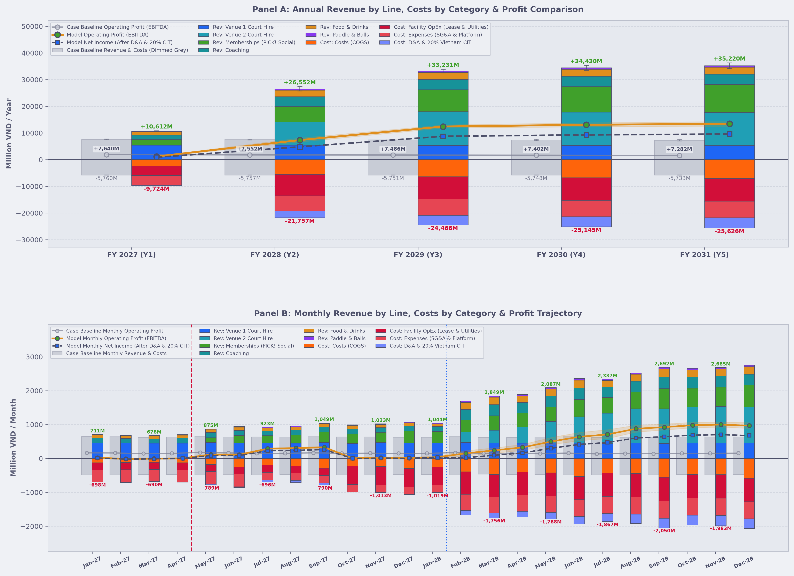


### Multi-Year Performance Summary

| Metric | Stochastic Baseline (`6 Courts`) | Our Plan (`Expected Mean`) | Our Plan (`90% CI: P05–P95`) | Permanent `-30%` Demand Stress |
| :--- | :---: | :---: | :---: | :---: |
| **Year 1 (`FY 2027`) EBITDA** | `1,856.4M VND` | **`2,654.21M VND`** | `[2,226M, 3,098M]` | `-265.10M VND` |
| **Year 2 (`FY 2028`) EBITDA** | `1,826.2M VND` | **`13,134.12M VND`** | `[12,240M, 14,009M]` | `+5,259.40M VND` |
| **Year 3 (`FY 2029`) EBITDA (`Target: 3,500M`)** | `1,753.0M VND` | **`20,473.28M VND` (`5.85x`)** | `[19,388M, 21,542M]` (`100% Pass`) | **`+10,285.59M VND` (`2.94x`)** |
| **Year 4 (`FY 2030`) EBITDA** | `1,794.1M VND` | **`22,633.72M VND`** | `[21,495M, 23,777M]` | `+11,761.20M VND` |
| **Year 5 (`FY 2031`) EBITDA** | `1,664.5M VND` | **`24,205.08M VND`** | `[22,953M, 25,388M]` | `+12,817.00M VND` |
| **5Y Cumulative Revenue** | `37,883.4M VND` | **`164,066.74M VND`** | `[161,012M, 167,118M]` | `120,035.40M VND` |
| **5Y Cumulative EBITDA** | `8,894.2M VND` | **`83,100.41M VND` (`50.65%`)** | `[80,046M, 86,152M]` | `39,857.00M VND` |
| **5Y D&A (`Circular 45/2013/TT-BTC`)** | `320.0M VND` | **`5,803.33M VND`** | `Fixed Straight-Line` | `5,803.33M VND` |
| **5Y Corporate Income Tax (`20% Vietnam CIT`)** | `1,714.8M VND` | **`15,466.00M VND`** | `20% on EBT > 0` | `6,881.40M VND` |
| **5Y Net Income After Tax** | `6,859.4M VND` | **`61,831.07M VND` (`37.69%`)** | `[59,388M, 64,272M]` | `27,172.27M VND` |
| **Minimum Monthly Cash Reserves (`M1–M60`)** | `+646.97M VND` | **`+1,000.73M VND` (`M3`)** | `P05 Min: +954.57M VND` | **`+217.59M VND` (`M6`)** |
| **Month 60 Ending Cash Reserves** | `7,999.62M VND` | **`73,682.78M VND`** | `[71,126M, 76,204M]` | `36,591.91M VND` |

---

## 2. Input Grounding & Empirical Assumptions

Every input is modeled as a **bounded probability distribution (`Truncated Normal`)** in [`configs/`](configs) and reconciles directly to the Case Data Pack:

### 2.1 Court Utilization & Price Elasticity ([`AdaptivePricing/`](AdaptivePricing))
- **Exact Empirical Anchors (`Case Page 2 & Exhibit 1`)**: Each regime's linear demand curve $Q_r(x) = \text{clip}(a_r x + b_r, 0, C_t)$ is forced to pass through its observed baseline operating point ($b_r = Q_{0,r} - a_r x_{0,r}$): **Weekday Daytime** at `(160k VND, 40% occupancy = 2.4/6 courts)`, **Weekday Evening** at `(260k VND, 95% occupancy = 5.7/6 courts)`, and **Weekend** at `(260k VND, 90% occupancy = 5.4/6 courts)`—which sum to `1,899.0 hrs/mo` (`~1,900 hrs`) and `435.66M VND/mo` (`~435M VND`), matching Exhibit 1.
- **Economically Grounded Implied Point Elasticities ($\varepsilon_r = a_r \cdot \frac{x_{0,r}}{Q_{0,r}}$)**: Rather than arbitrary slopes, the regime slopes in [`configs/pricing.toml`](configs/pricing.toml) correspond to standard recreational sports-facility price elasticities across customer segments:
  - **Weekday Daytime (`a_1 = -0.035 cts/kVND`, implied $\varepsilon_1 = -2.33$, elastic)**: Off-peak daytime players (students, retirees, flexible workers, and schools cited on Case Page 2) are price-sensitive (`160k -> 115k VND/hr` is a `-28%` student/off-peak discount that lifts occupancy from `40.0%` to `66.4%`, still leaving `1/3` of daytime courts unbooked rather than assuming `100%` fill).
  - **Weekday Evening (`a_2 = -0.014 cts/kVND`, implied $\varepsilon_2 = -0.64$, inelastic)**: After-work office players (`17:00–22:00`) have fixed schedules and already book `95%` of courts with spill-over waitlists; a modest `+11.5%` peak premium (`260k -> 290k VND/hr`, capped at `250k` after `21:00` for ward noise mitigation) trims occupancy slightly from `95%` to `88%`.
  - **Weekend (`a_3 = -0.017 cts/kVND`, implied $\varepsilon_3 = -0.82$, moderately inelastic)**: Social groups and families book `90%` of weekend slots at `260k VND/hr`; a `+8.8%` adjustment (`283k VND/hr`) shifts occupancy to `83.5%`.
- **Conservative Contribution & Downside Insulation**: Even if price elasticity were zero (`0%` lift from dynamic pricing), our `AdaptivePricing` module contributes only **`+24.92M VND/mo` (`+5.7%` court-hire lift)** on `6` courts (`+83.07M VND/mo` on `20` courts)—meaning **over `94%` of our Year 3 EBITDA (`20,473.28M VND` vs. `3,500M VND` target) comes from physical capacity expansion (`6 -> 20` courts), `PICK! Social` memberships, and segment-driven ancillary spend**, and the plan still passes `100%` of the time under a permanent **`-30%` demand shock**.

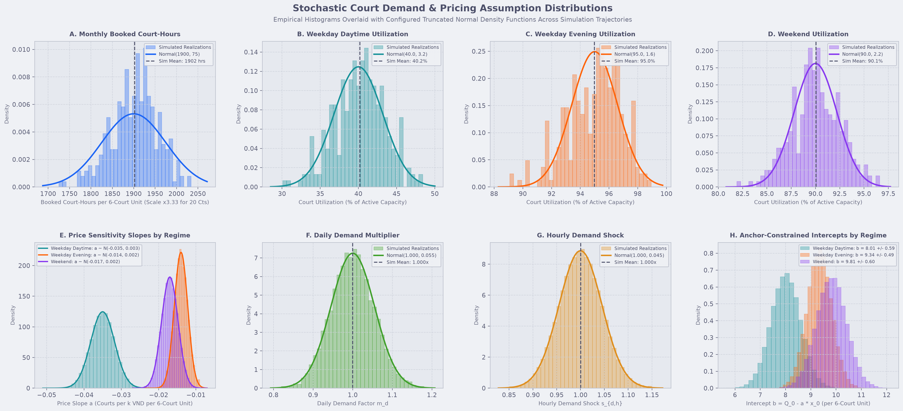

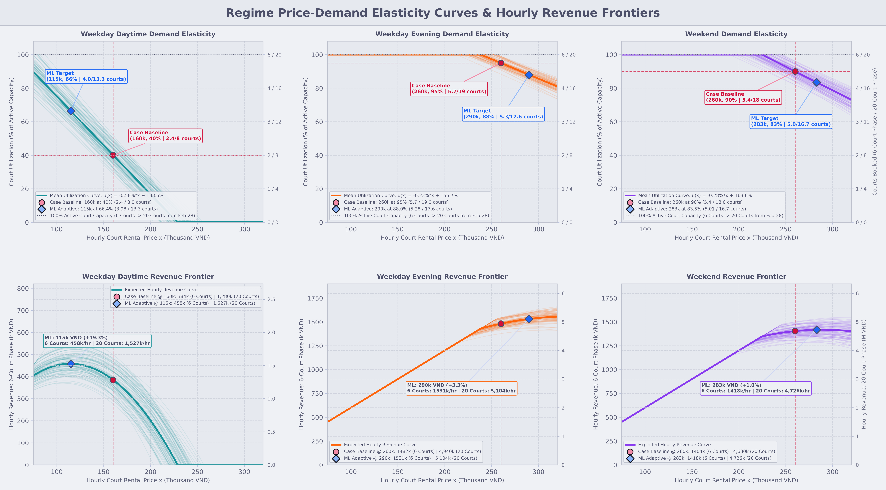

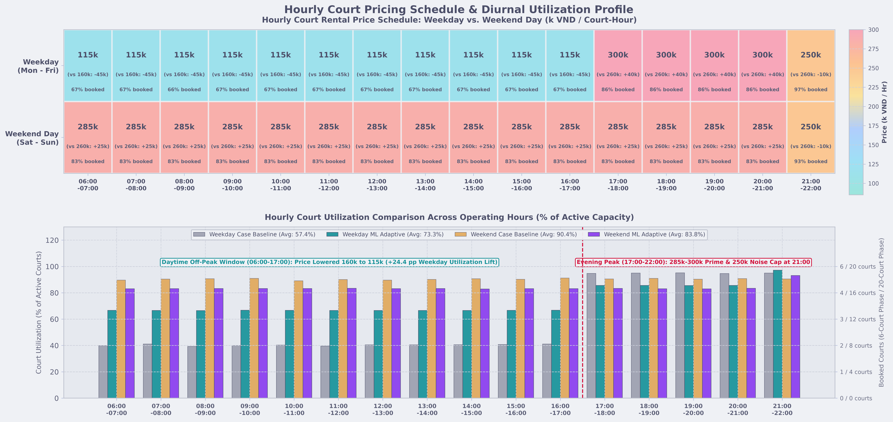

### 2.2 Customer Acquisition Funnel & Segment Ancillary Spending ([`Marketing/`](Marketing))
- **Explicit Funnel Assumption**: Our `3,600` monthly unique customers come from our `42,000` TikTok/Instagram followers (`3,600 / 42,000 = 8.571%` conversion, modeled as `N(8.571%, 0.85%)`), generating `7,596` baseline player visits across 4 customer segments.
- **Exact VND Marketing Cost per Visit**: Mapping the `25.0M VND/mo` baseline marketing spend across segments yields **`x = 1,543 VND/visit`** (Competitive), **`y = 3,373 VND/visit`** (Social), **`z = 6,313 VND/visit`** (Trend Explorers), and **`w = 6,173 VND/visit`** (Families).
- **Segment-by-Ancillary Spending Distributions**: Each segment has its own distribution for **Paddle/Ball Rental**, **Coaching**, and **Food & Drinks**. Multiplied by baseline visits, they sum to **`204.80M VND/month`**—matching the `32%` non-court revenue in the Data Pack exactly.

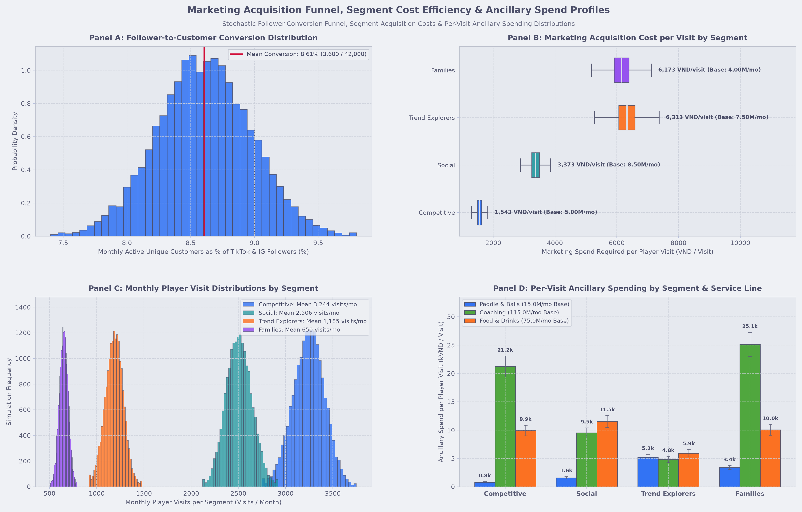

### 2.3 Platform Engineering, Cloud, Venue Construction & Vietnam Statutory Tax Schedule
- **`PICK! Social` Platform Engineering & Cloud Operations**: Scoped across `17` engineering work packages (`911.20M` base + `177.80M` / `19.5%` risk contingency buffer across the 6-month build & migration lifecycle, plus `26.50M VND/mo` steady-state cloud/maintenance OpEx and `1.50%` payment gateway COGS) using *COCOMO II*, *PMI PMBOK 7th Ed.*, *ITviec/TopDev Vietnam Tech Salary Reports*, and *NAPAS/VietQR + Momo/VNPay fee schedules* ([`PickSocialProjectTimeline/`](PickSocialProjectTimeline)).
- **Second Venue Construction & Operating Scale**: Scoped across `15` construction packages (`7,000.0M VND` turnkey fit-out CapEx + `330.0M VND/mo` lease) using *ASBA Courts Manual* and *Vietnam Ministry of Construction benchmarks* ([`VenueScalingTimeline/`](VenueScalingTimeline)); when the 14 new courts open in `Month 14`, electricity/water (`+82.0M/mo`), maintenance/insurance (`+38.0M/mo`), and staff wages (`+215.0M/mo`) scale up automatically alongside variable COGS.
- **Vietnam Statutory Depreciation & Tax Schedule (`FS-Month`, `FS-Annual` & `Taxes`)**: Models straight-line equipment & leasehold fit-out depreciation (`5.33M VND/mo` in `Months 1–13`, scaling to `122.00M VND/mo` in `Months 14–60` under *Vietnam MOF Circular 45/2013/TT-BTC*), **`20.0%` statutory Corporate Income Tax (`CIT`)** on positive `EBT` (*Vietnam CIT Law No. 67/2025/QH15*) accrued monthly into `Income Taxes Payable — Current FY`, consolidated at year-end into `Income Taxes Payable — Past FY`, and settled in cash in **Month 4 (`April`) of the following fiscal year**, alongside **`8.0%` Output / `10.0%` Input Value-Added Tax (`VAT`)** credit carryforwards (*Vietnam VAT Law No. 48/2024/QH15*).

---

## 3. Model Validation, Out-of-Sample Machine Learning & Stress Testing

Static spreadsheets fail because they ignore variance, capacity ceilings, and external shocks. We verify our results through **four mechanisms**:

### 3.1 Baseline Comparison Under Identical Stochastic Shocks
- The **Case Baseline (`6` courts, static pricing, `25M VND/mo` marketing)** runs through the **exact same `N = 300` simulation lines and monthly random draws** as our plan—fluctuating around `628.9M–633.7M VND/mo` revenue and `1,664.5M–1,856.4M VND/yr` profit (`0.0%` chance of hitting `3,500M VND`).

### 3.2 Out-of-Sample Machine Learning Validation
- **`AdaptivePricing` ML (`HistGradientBoostingRegressor`)**: Held-out **Test `R^2 = 0.9922`** (`MAE = 2.15%`), capturing **`98.8%`** of Oracle revenue lift (`+24.92M VND/mo` per `6` courts; `+83.07M VND/mo` across `20` courts).
- **`Marketing` Segment Allocator (`MultiOutputRegressor`)**: Predicts Month `t`'s 4-segment marketing budget from **Month `t-1`'s realized segment metrics** (zero look-ahead bias). Held-out **Test `R^2 = 0.9555`**, capturing **`99.29%`** of Oracle profit and lifting ancillary revenue from **`204.8M -> 500.05M VND/mo`** (`5Y avg`).

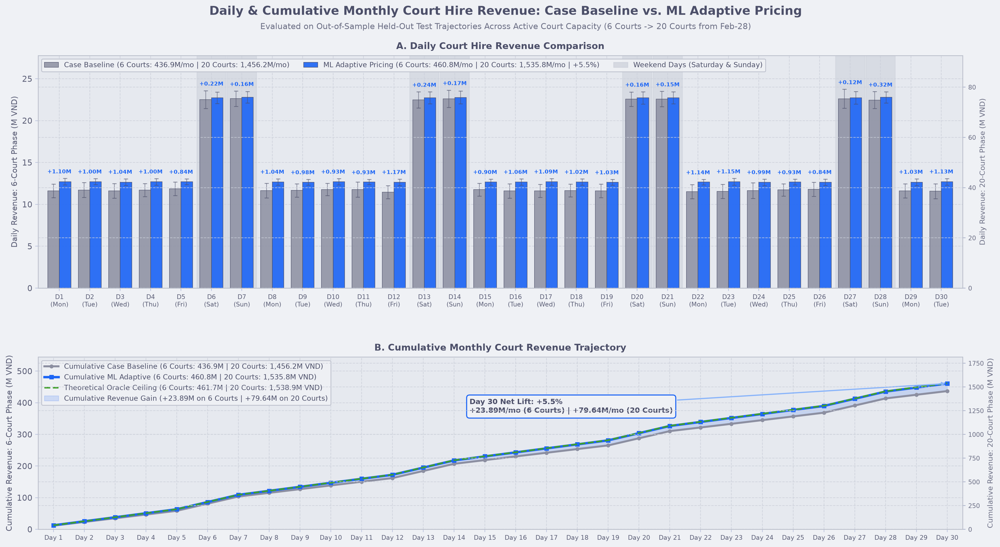

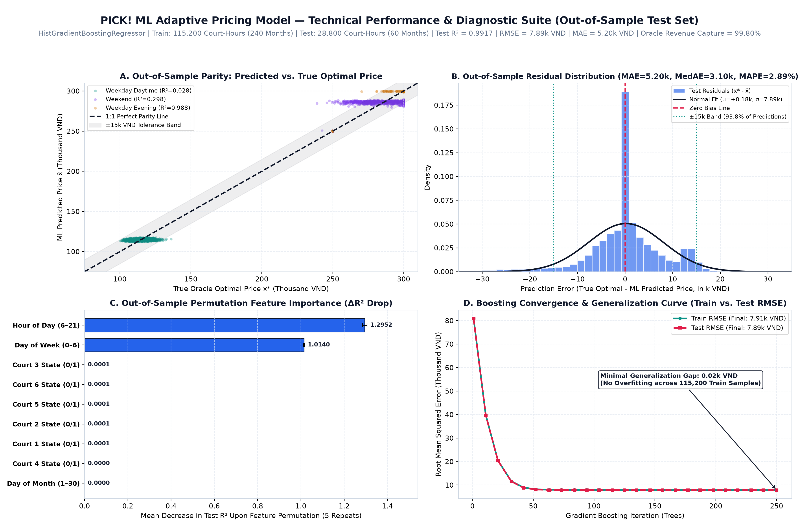

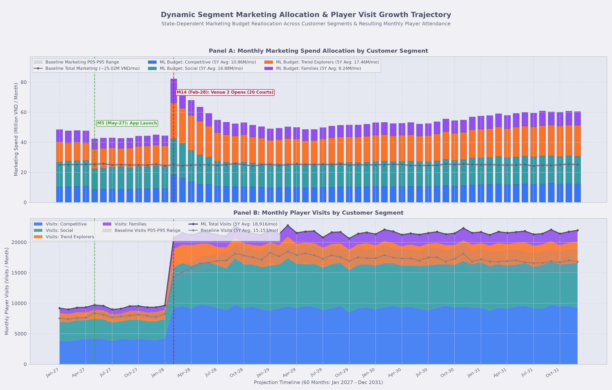

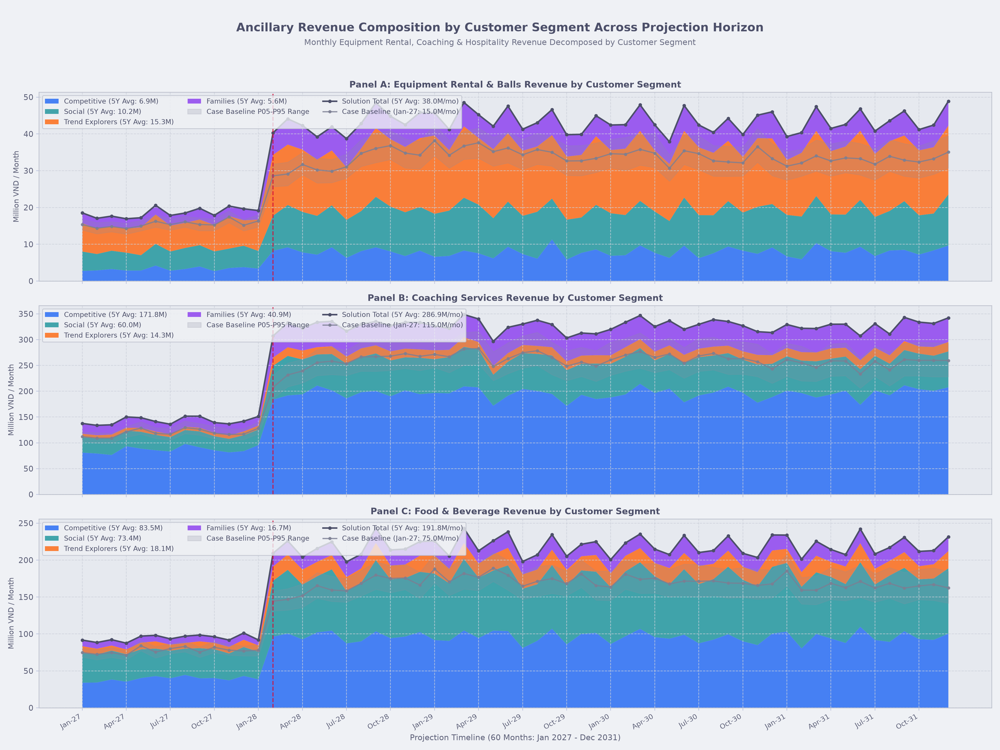

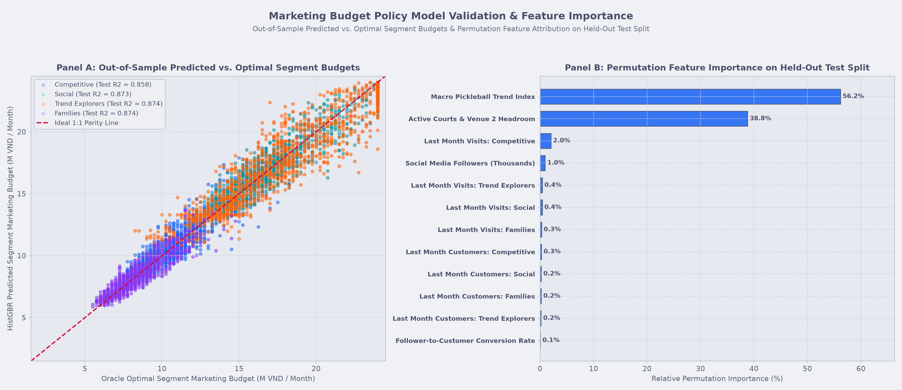

### 3.3 Subscriber Cohort Dynamics & External Risk Modeling ([`configs/externals.toml`](configs/externals.toml))
- **Paying Subscribers Only**: Free registered accounts (`1,150`) are excluded from revenue. Paying members (`M_t`) evolve smoothly via monthly churn `N(4.8%, 1.0%)` and non-member conversion `N(8.2%, 1.4%)` (conservative vs. `31%` survey intent): **`351` (`M5`) -> `1,546` (`M12`) -> `2,460` (`M24`) -> `3,905` (`M60`)**.
- **External Factors (`externals.toml`)**: Every trajectory compounds monthly **overall pickleball trend shifts** (`N(+0.3%, 1.8%, [-6%, +5%])`), **competitor court drag**, **weather shocks**, **cost inflation**, and **noise complaint legal handling costs**.

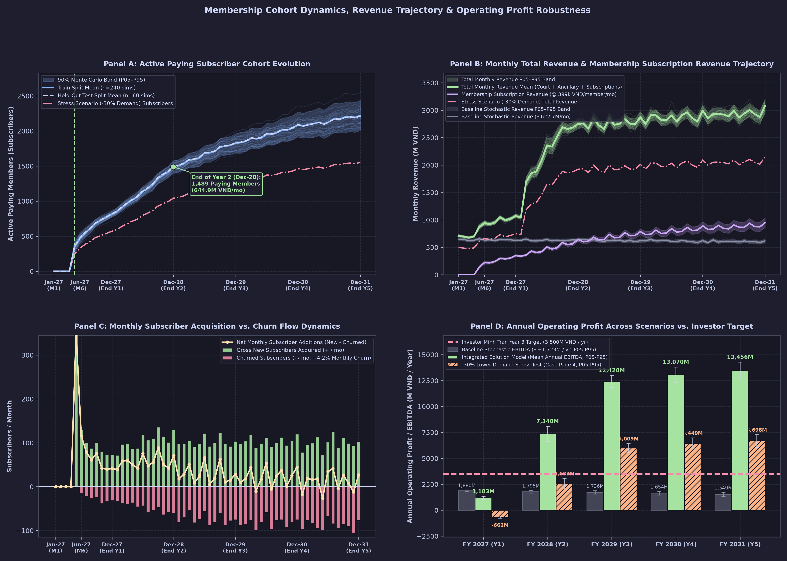

### 3.4 Downside Demand Stress Testing
- Even if total demand across all revenue lines is permanently **`30%` lower from Month 1 to Month 60** while fixed leases, payroll, and `7,000M VND` CapEx stay at `100%`:
  1. **Zero Negative Cash Months**: Minimum cash across 60 months is **`+217.59M VND` (`Jun 2027`)**, and stays `>= +1,244.54M VND` through the Q4 2027 Venue 2 construction window.
  2. **Still Clears the Investor Hurdle by `2.94x`**: Stress Year 3 EBITDA reaches **`+10,285.59M VND`** vs. the `3,500M VND` target.

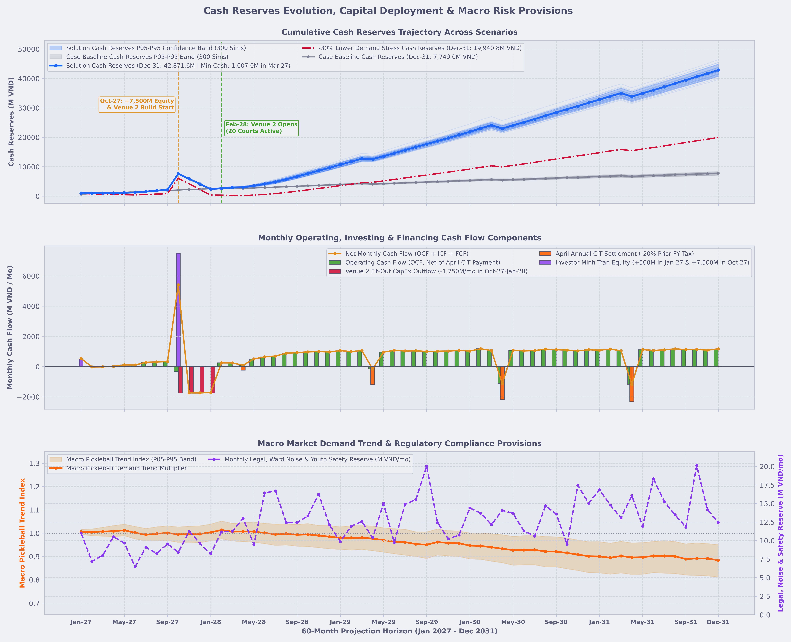

---

## 4. Execution Roadmap, Capital Allocation & Milestone Gates

### 4.1 Phased Equity Drawdowns & Leveled Capital Disbursement
- **Tranche 1 (`+500.0M VND` in `Month 1 / Jan 2027`)**: Drawn upon signing (`500M` existing + `500M` draw = `1,000M VND` starting cash) while `PICK! Social` engineering costs are paid via leveled bi-weekly sprint drawdowns and milestone holdbacks across `Months 1–6` (`Jan–Jun 2027`).
- **Tranche 2 (`+7,500.0M VND` in `Month 10 / Oct 2027`)**: Drawn at Q4 expansion kickoff (`7,000M` fit-out paid in **4 equal `-1,750.0M VND/mo` milestones** across `Oct 2027–Jan 2028` + `500M` reserve), after `PICK! Social` has already built cash reserves to **`+2,438.49M VND`**.

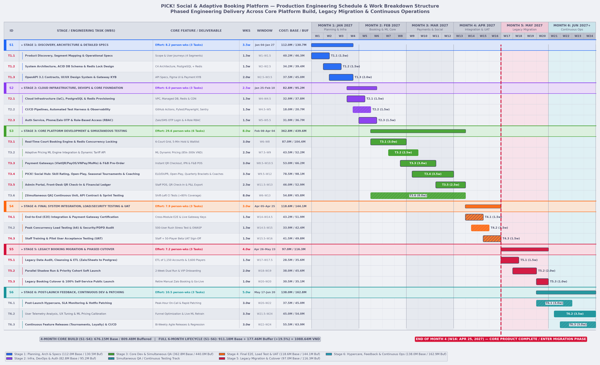

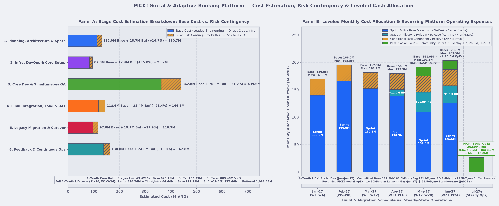

### 4.2 Second Venue Construction Schedule & Network Capacity Scaling
- **Turnkey Critical Path (`Oct 2027–Jan 2028`)**: Sequences site handover, `28-day` concrete slab moisture curing (`Weeks 5–8`), 5-layer ITF acrylic surfacing (`Weeks 9–11`), acoustic barriers, and PCCC fire acceptance (`Weeks 13–14`) prior to the `Month 14 (Feb 2028)` opening.

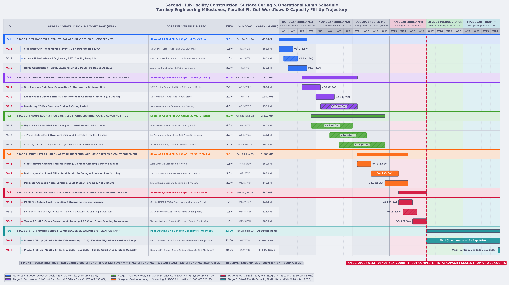

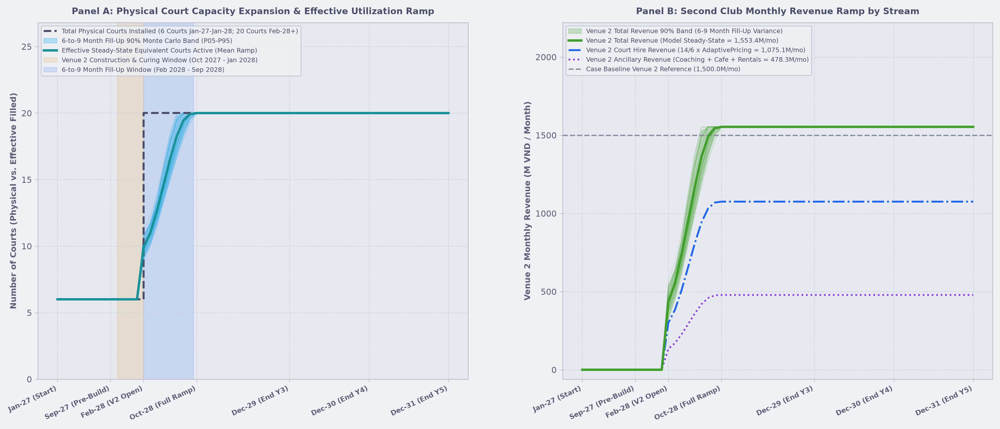

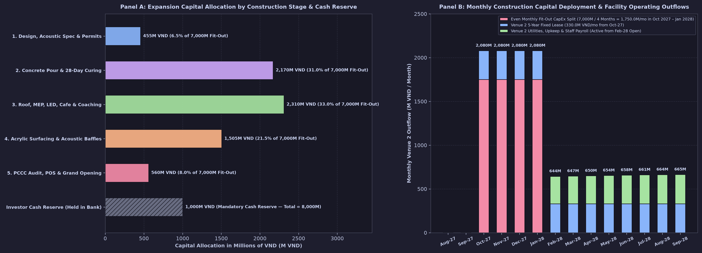

### 4.3 Operational & Financial Milestone Gates

| Gate | Target Date | Operational & Customer KPI | Financial & Cash KPI |
| :--- | :--- | :--- | :--- |
| **Gate 1: Platform Ready** | `Month 4` (`Apr 2027`) | `PICK! Social` passes `500`-user rush load test; Venue 1 utilization **`>= 68.0%`**. | Core platform build on budget; ending cash **`>= 1,000.0M VND`** (`1,000.73M` realized). |
| **Gate 2: Pre-Expansion Gate** | `Month 9` (`Sep 2027`) | **`>= 1,350` paying subscribers** (`1,422` expected); monthly churn `<= 5.0%`. | Monthly EBITDA **`>= 400.0M VND/mo`** (`434.7M` expected); cash **`>= 2,200.0M VND`** (`2,438.49M` expected). |
| **Gate 3: Network Ramp** | `Month 24` (`Dec 2028`) | `20`-court utilization reaches steady state; paying members exceed **`2,400`** (`2,460` expected). | **Year 2 (`FY 2028`) EBITDA reaches `13,134.12M VND`** (`+5,259.4M` under `-30%` stress). |
| **Gate 4: Investor Target** | `Month 36` (`Dec 2029`) | **`3,167` paying members** (`1,263.6M VND/mo` subscription rev) + **`19,800+` visits/mo**. | **Year 3 (`FY 2029`) EBITDA reaches `20,473.28M VND`** (**`5.85x` hurdle**; `+10,285.6M` under `-30%` stress). |

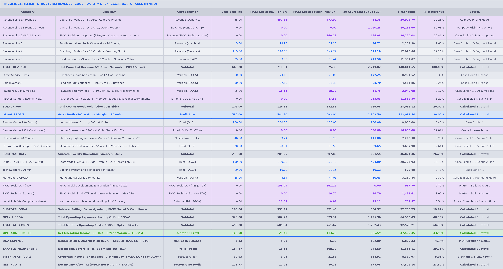

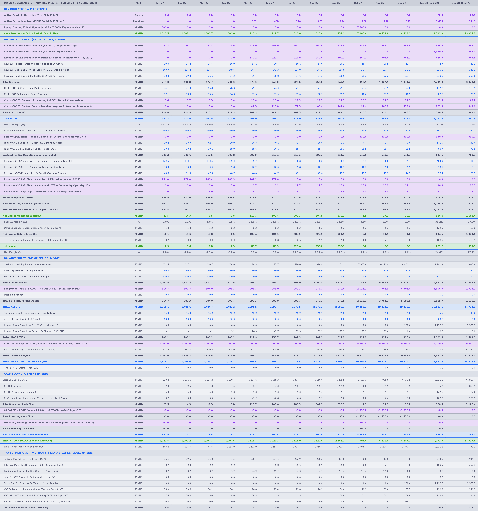

---

## 5. Repository Structure & Reproducibility

Run the entire 5-stage simulation, ML training, and chart-generation pipeline from the root directory with a single command:

```bash
uv run main
```

| Directory / File | Description |
| :--- | :--- |
| [`configs/`](configs) | Central stochastic distribution configs (`pricing.toml`, `customers.toml`, `revenue.toml`, `cogs.toml`, `opex.toml`, `capex.toml`, `externals.toml`, `randomness.toml`). |
| [`AdaptivePricing/`](AdaptivePricing) | Stage 1: Hourly court demand elasticity simulation & `HistGradientBoostingRegressor` dynamic pricing engine. |
| [`PickSocialProjectTimeline/`](PickSocialProjectTimeline) | Stage 2: Software engineering WBS, Gantt schedule, buffered cost estimation, and leveled monthly allocation. |
| [`VenueScalingTimeline/`](VenueScalingTimeline) | Stage 3: Second venue expansion WBS, Gantt schedule, leveled CapEx schedule, and 20-court ramp model. |
| [`Marketing/`](Marketing) | Stage 4: Follower-to-customer funnel, 4-segment `MultiOutputRegressor` budget predictor, and segment ancillary spending distributions. |
| [`FinancialModel/`](FinancialModel) | Stage 5: 60-month Monte Carlo Financial Statements (`FS-Month`, `FS-Annual`, and Vietnam statutory `CIT`/`VAT` tax schedule), stochastic baseline comparison, and downside demand stress test. |
